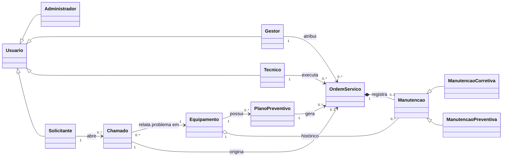
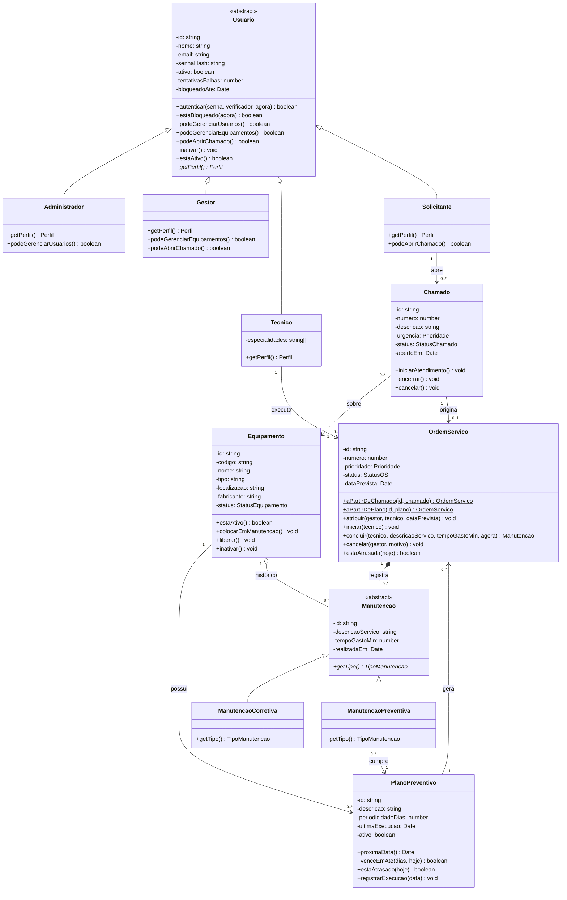
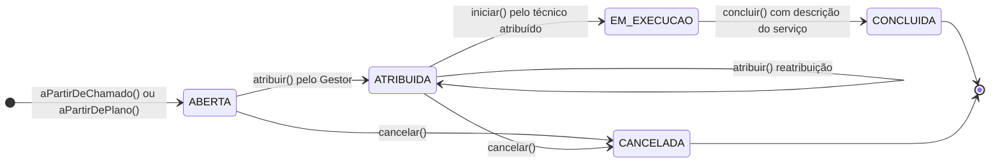
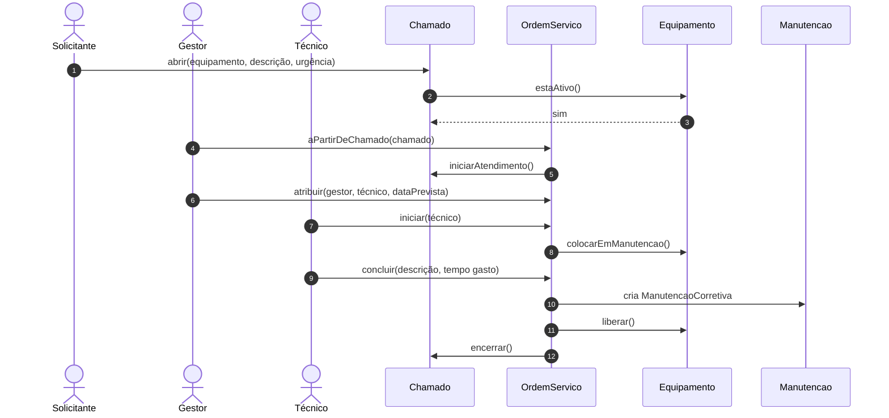

# Modelo de Domínio — Operix

> Entrega: Modelo de domínio (07/10 e 14/10). Status: versão 1.0.
> Diagramas também disponíveis como imagem em [diagramas](diagramas).
> Responsáveis: André Neves (Tech Lead), Gerardo Mota e Matheus Oliveira (Back-end).

## 1. O que é o modelo de domínio

O **domínio** é o assunto do negócio que o sistema atende. No Operix, o domínio é a **gestão de manutenção**: equipamentos que quebram, pessoas que pedem conserto, técnicos que executam e gestores que planejam.

O **modelo de domínio** é a representação desse negócio em forma de **conceitos (classes)**, com:

- os **dados** que cada conceito guarda (atributos);
- o que cada conceito **sabe fazer** (métodos);
- como os conceitos **se relacionam** (associações, herança, multiplicidade);
- as **regras** que nunca podem ser quebradas (invariantes).

Ele é independente de tela, de banco de dados e de framework. É o "coração" do sistema: o front-end, a API e o banco existem para servir a esse modelo. Em Programação Orientada a Objetos, cada conceito do modelo vira uma **classe**, e as regras de negócio viram **métodos** dessas classes.

| O modelo de domínio é | O modelo de domínio não é |
|---|---|
| A linguagem do negócio em forma de classes | O desenho das tabelas do banco |
| Onde ficam as regras de negócio | Uma lista de telas |
| Comportamento + dados | Apenas uma lista de campos |

## 2. Glossário do domínio (linguagem comum)

Termos usados por toda a equipe, no código, na documentação e nas conversas com o cliente.

| Termo | Significado |
|---|---|
| Equipamento | Bem da empresa que recebe manutenção: máquina, instalação ou dispositivo. Identificado por um código único. |
| Chamado | Pedido de manutenção feito por um solicitante, relatando um problema em um equipamento. |
| Ordem de Serviço (OS) | Trabalho planejado de manutenção, atribuído a um técnico, com data prevista. Nasce de um chamado ou de um plano preventivo. |
| Manutenção | Registro do serviço efetivamente realizado em um equipamento. Pode ser corretiva ou preventiva. |
| Manutenção corretiva | Conserto feito depois de uma falha (origem: chamado). |
| Manutenção preventiva | Intervenção programada para evitar falhas (origem: plano preventivo). |
| Plano preventivo | Programação de manutenção periódica de um equipamento (ex.: a cada 30 dias). |
| Solicitante | Usuário que abre chamados. |
| Técnico | Usuário que executa ordens de serviço. |
| Gestor | Usuário que gera e atribui ordens de serviço, planeja preventivas e acompanha indicadores. |
| Administrador | Usuário que gerencia usuários e perfis. |
| Prioridade | Urgência do atendimento: Baixa, Média, Alta ou Crítica. |

## 3. Visão geral: conceitos e relacionamentos



Como ler: um **solicitante** abre **chamados** sobre um **equipamento**; cada chamado pode originar **uma ordem de serviço**; ordens também podem ser geradas por um **plano preventivo**; o **gestor** atribui a ordem a um **técnico**; ao ser concluída, a ordem registra uma **manutenção**, que entra no **histórico** do equipamento.

## 4. Diagrama de classes detalhado



Os tipos de status e prioridade são **enumerações** (conjuntos fechados de valores):

| Enumeração | Valores |
|---|---|
| `Perfil` | ADMINISTRADOR, GESTOR, TECNICO, SOLICITANTE |
| `StatusEquipamento` | ATIVO, EM_MANUTENCAO, INATIVO |
| `StatusChamado` | ABERTO, EM_ATENDIMENTO, ENCERRADO, CANCELADO |
| `StatusOS` | ABERTA, ATRIBUIDA, EM_EXECUCAO, CONCLUIDA, CANCELADA |
| `Prioridade` | BAIXA, MEDIA, ALTA, CRITICA |
| `TipoManutencao` | CORRETIVA, PREVENTIVA |

Legenda: `-` privado, `+` público, `*` método abstrato, `$` método estático (de fábrica), `<|--` herança, `*--` composição (a parte não existe sem o todo), `o--` agregação, `-->` associação.

## 5. Ciclo de vida da Ordem de Serviço

A ordem de serviço muda de estado somente pelos seus próprios métodos. Qualquer outra transição é recusada.



Efeitos em outros objetos:

| Transição da OS | Efeito no equipamento | Efeito no chamado | Efeito no plano |
|---|---|---|---|
| Criada a partir de chamado | — | ABERTO → EM_ATENDIMENTO | — |
| ATRIBUIDA → EM_EXECUCAO | ATIVO → EM_MANUTENCAO | — | — |
| EM_EXECUCAO → CONCLUIDA | EM_MANUTENCAO → ATIVO | → ENCERRADO | registra a execução e recalcula a próxima data |

## 6. Fluxo principal entre os objetos



## 7. Regras de negócio dentro das classes

Cada regra fica no objeto responsável por ela. Assim, nenhuma tela ou endpoint consegue quebrá-la.

| Regra | Onde é garantida |
|---|---|
| Código do equipamento é único (RN01) | Verificado ao cadastrar o `Equipamento` (repositório) |
| Usuário inativo não acessa o sistema (RN02) | `Usuario.autenticar()` recusa quando `ativo = false` |
| Não abrir chamado para equipamento inativo (RN03) | Construtor de `Chamado` chama `equipamento.estaAtivo()` |
| OS só é executada depois de atribuída (RN04) | `OrdemServico.iniciar()` exige status ATRIBUIDA |
| Só o técnico atribuído inicia a OS (UH06 CA01) | `OrdemServico.iniciar(tecnico)` compara com o técnico atribuído |
| OS concluída ou cancelada não muda mais (RN05) | Todos os métodos de `OrdemServico` verificam o status atual |
| Concluir exige descrição do serviço (RN06) | Construtor de `Manutencao` recusa descrição vazia |
| Preventiva segue a periodicidade (RN07) | `PlanoPreventivo.proximaData()` = última execução + periodicidade |
| Só o gestor atribui OS (RN08) | `OrdemServico.atribuir(gestor: Gestor, ...)` só aceita um objeto do tipo `Gestor` |
| Prioridades válidas (RN09) | Enumeração `Prioridade` |
| Toda OS tem exatamente uma origem | Construtor privado; só os métodos de fábrica `aPartirDeChamado()` e `aPartirDePlano()` criam OS |

## 8. Os quatro pilares de POO no modelo

| Pilar | Onde aparece no Operix |
|---|---|
| **Encapsulamento** | Todos os atributos são privados. O status da OS, do chamado e do equipamento só muda por métodos de negócio (`atribuir()`, `iniciar()`, `concluir()`), que validam as regras antes de mudar o estado. |
| **Herança** | `Administrador`, `Gestor`, `Tecnico` e `Solicitante` herdam de `Usuario`. `ManutencaoCorretiva` e `ManutencaoPreventiva` herdam de `Manutencao`. |
| **Polimorfismo** | `getPerfil()` e `getTipo()` têm uma implementação em cada subclasse. Ao concluir, a OS cria uma manutenção corretiva ou preventiva conforme a origem, e o histórico trata todas como `Manutencao`. |
| **Abstração** | `Usuario` e `Manutencao` são classes abstratas: não existe "um usuário genérico" nem "uma manutenção genérica", só os tipos concretos. |

## 9. Implementação (TypeScript)

O modelo já está implementado em [`backend/src/domain`](../../backend/src/domain), com testes unitários em [`dominio.spec.ts`](../../backend/src/domain/dominio.spec.ts). Trecho da classe `OrdemServico`: as regras ficam na própria classe, e não nos controllers.

```ts
  /** Só o técnico atribuído inicia (RN04, RN10, UH06-CA01). */
  iniciar(tecnico: Tecnico): void {
    this.exigirStatus(StatusOS.ATRIBUIDA);
    exigir(this.tecnico !== null && tecnico.getId() === this.tecnico.getId(), 'Somente o técnico atribuído pode iniciar a ordem de serviço.', 'RN10');
    this.equipamento.colocarEmManutencao();
    this.status = StatusOS.EM_EXECUCAO;
  }

  /**
   * Conclui a OS e registra a manutenção (UH06-CA03 a CA05). Polimorfismo: a manutenção
   * criada é corretiva ou preventiva conforme a origem da OS.
   */
  concluir(tecnico: Tecnico, descricaoServico: string, tempoGastoMin: number, agora: Date): Manutencao {
    this.exigirStatus(StatusOS.EM_EXECUCAO);
    const atribuido = this.tecnico as Tecnico;
    exigir(tecnico.getId() === atribuido.getId(), 'Somente o técnico atribuído pode concluir a ordem de serviço.', 'RN10');
    const manutencao = this.plano
      ? new ManutencaoPreventiva(this.equipamento, atribuido, descricaoServico, tempoGastoMin, agora, this.plano)
      : new ManutencaoCorretiva(this.equipamento, atribuido, descricaoServico, tempoGastoMin, agora);
    this.manutencao = manutencao;
    this.status = StatusOS.CONCLUIDA;
    this.equipamento.liberar();
    this.chamado?.encerrar();
    this.plano?.registrarExecucao(agora);
    return manutencao;
  }
```

## 10. Rastreabilidade: classes e histórias de usuário

| Classe | Histórias |
|---|---|
| `Usuario` e subclasses | UH01 Autenticação, UH02 Usuários e perfis |
| `Equipamento` | UH03 Equipamentos, UH08 Histórico |
| `Chamado` | UH04 Chamados |
| `OrdemServico` | UH05 Geração e atribuição, UH06 Execução |
| `PlanoPreventivo` | UH07 Manutenção preventiva |
| `Manutencao` e subclasses | UH06 Execução, UH08 Histórico e indicadores |

## 11. Decisões de modelagem

| Decisão | Motivo |
|---|---|
| Perfis como subclasses de `Usuario` (e não só um campo "perfil") | Cada perfil tem comportamento próprio (o técnico tem especialidades; só o gestor atribui OS) e demonstra herança e polimorfismo. |
| `Chamado` separado de `OrdemServico` | O chamado é o pedido do solicitante; a OS é o trabalho planejado. Nem todo chamado vira OS, e preventivas geram OS sem chamado. |
| `Manutencao` criada somente pela OS (composição) | Garante que todo registro de manutenção tenha uma OS de origem, um técnico e uma data. |
| Status como enumerações | Impede valores inválidos e deixa o ciclo de vida explícito. |
| Modelo de domínio separado do banco | O Prisma define as tabelas; as classes de domínio guardam o comportamento. O repositório converte um no outro. |
