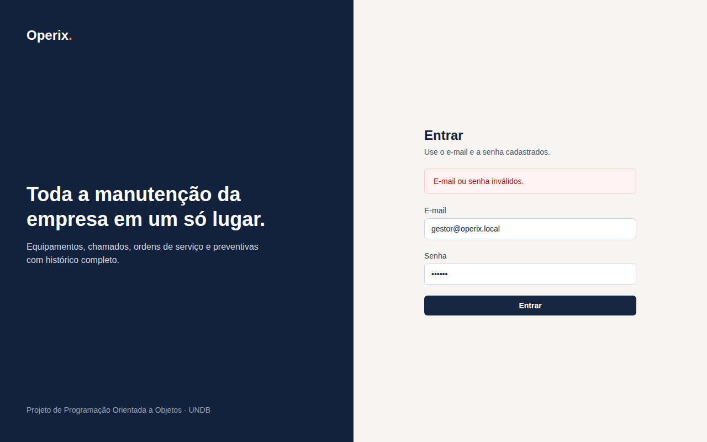
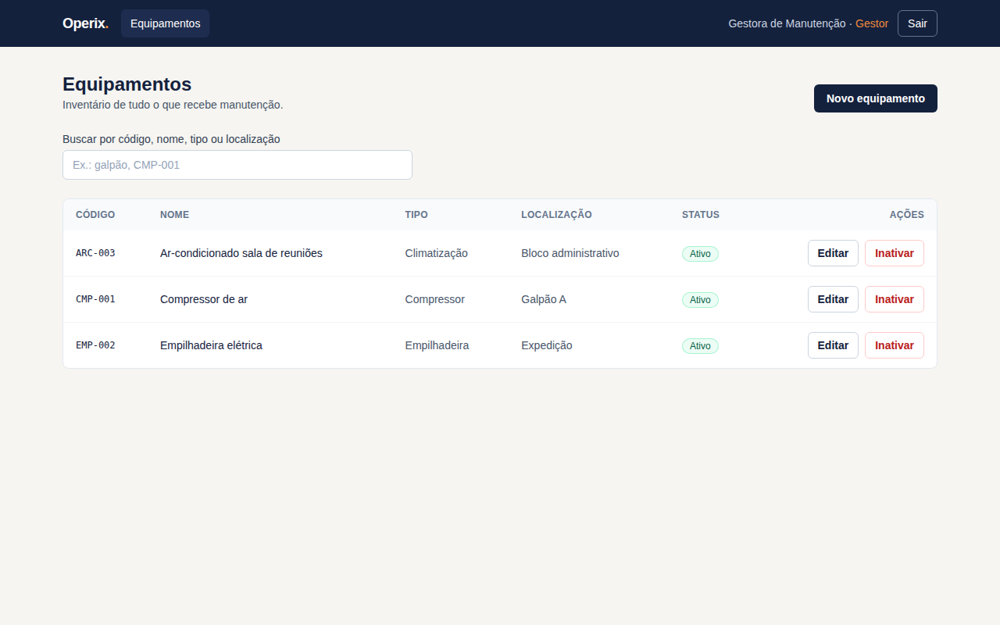
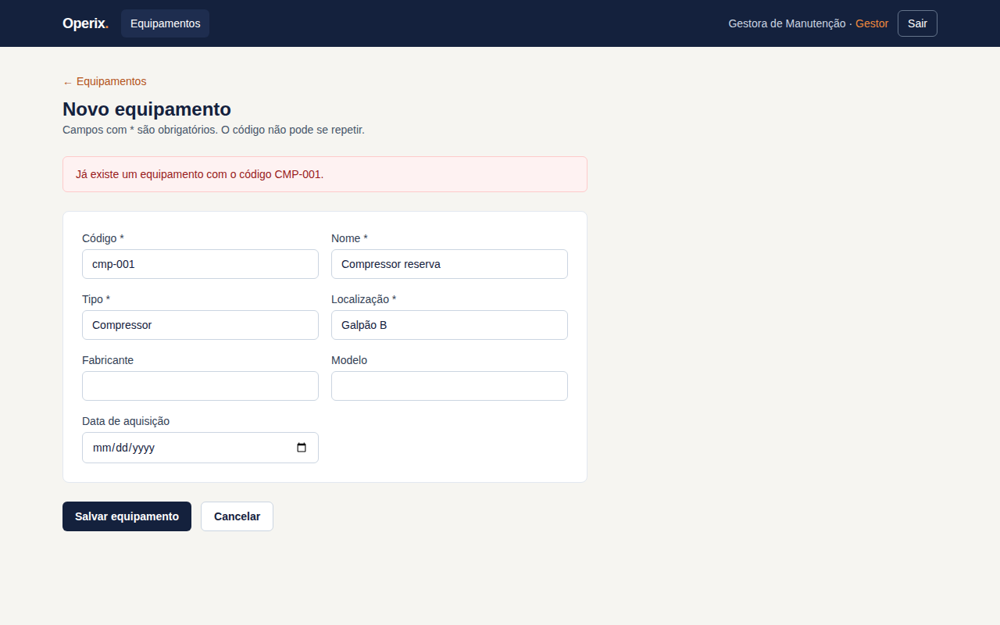
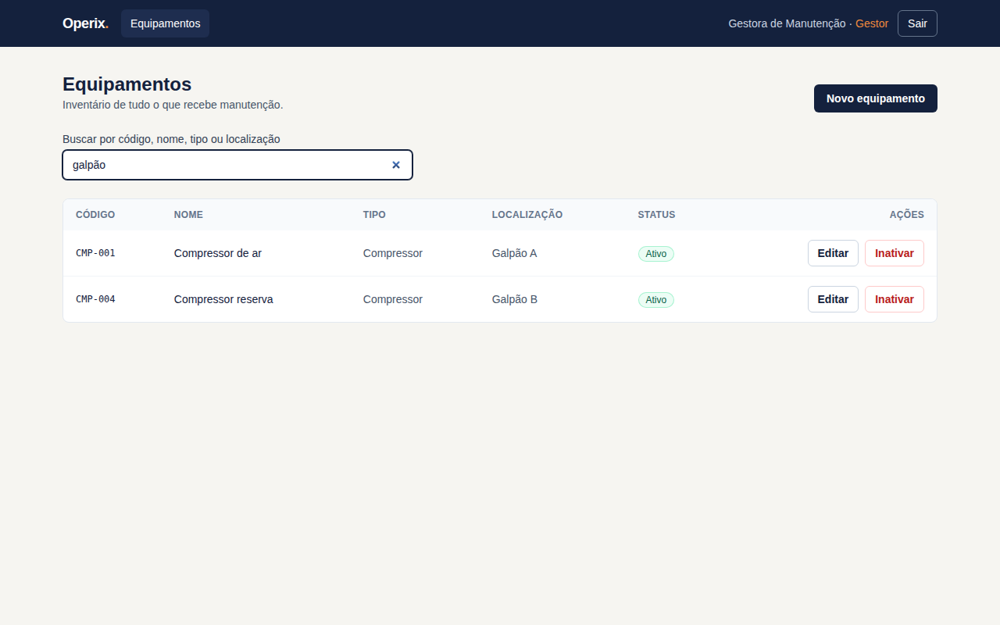
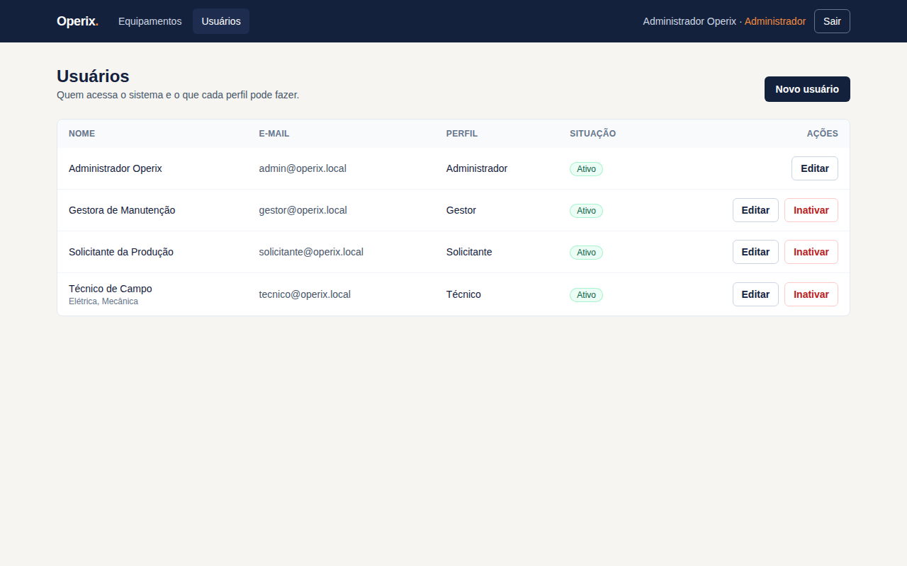
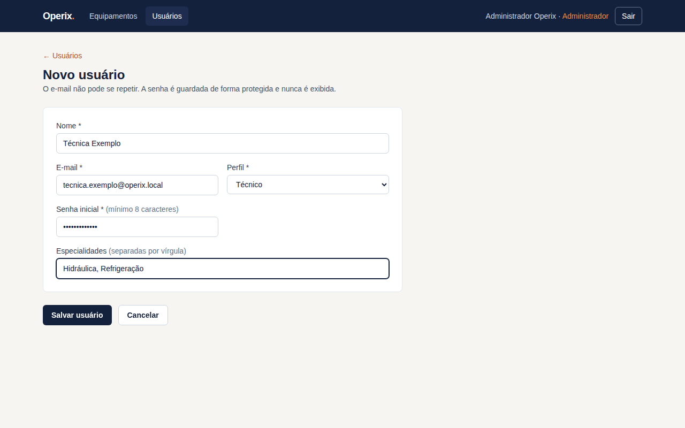
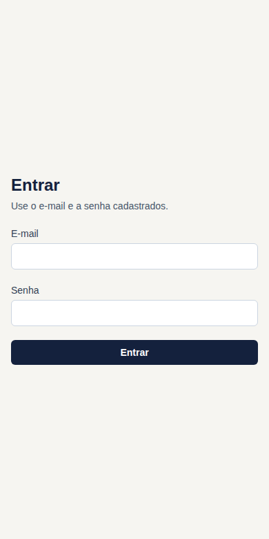
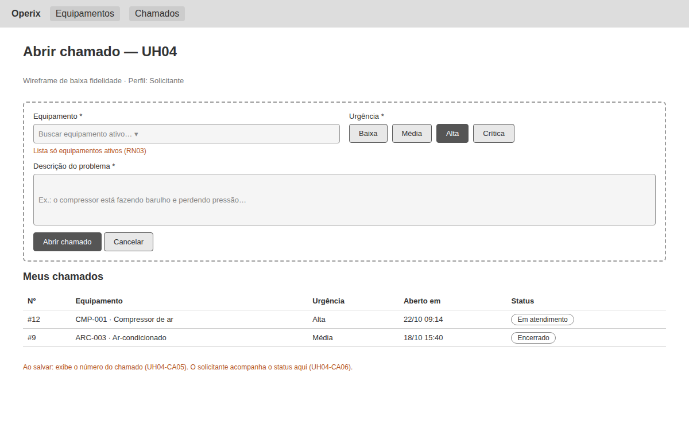
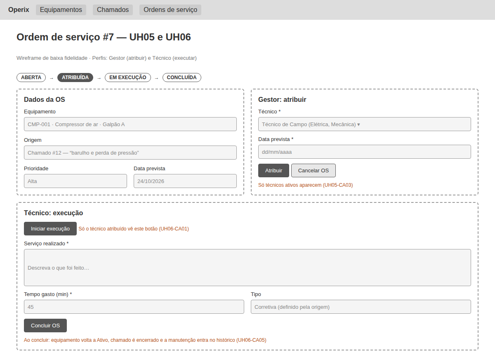

# Documentação do front-end

## Telas implementadas (Sprint 1)

| Tela | Imagem |
|---|---|
| Login com mensagem genérica de erro (UH01-CA03) |  |
| Lista de equipamentos (gestor) |  |
| Cadastro recusado por código repetido (UH03-CA02) |  |
| Busca por localização (UH03-CA06) |  |
| Lista de usuários (administrador) |  |
| Cadastro de técnico com especialidades (UH02) |  |
| Login no celular |  |

## Wireframes (Sprint 2)

| Tela | Imagem |
|---|---|
| Abrir chamado (UH04) |  |
| Ordem de serviço: atribuir e executar (UH05, UH06) |  |
